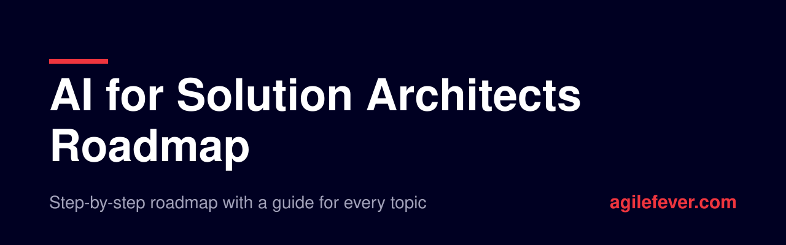

# AI for Solution Architects Roadmap

> AI for Solution Architects Roadmap - A step-by-step roadmap to design, secure, cost and get approval for AI systems with RAG, agents and LLMOps, with a blog for every topic

## Table of Contents

- [Who is a Solution Architect in the AI Era?](#who-is-a-solution-architect-in-the-ai-era)
- [How to Use This Roadmap](#how-to-use-this-roadmap)
- [Step 0: Must Know](#step-0-must-know)
- [Step 1: Gen AI Foundations for Architects](#step-1-gen-ai-foundations-for-architects)
- [Step 2: From Solution Architect to AI Solution Architect](#step-2-from-solution-architect-to-ai-solution-architect)
- [Step 3: Platforms and Vendor Decision Framework](#step-3-platforms-and-vendor-decision-framework)
- [Step 4: Architecture Documents, RFPs and Proposals with AI](#step-4-architecture-documents-rfps-and-proposals-with-ai)
- [Step 5: RAG Pipeline and Retrieval Architecture](#step-5-rag-pipeline-and-retrieval-architecture)
- [Step 6: Multi-Agent System Architecture](#step-6-multi-agent-system-architecture)
- [Step 7: LLMOps and Production Deployment](#step-7-llmops-and-production-deployment)
- [Step 8: FinOps: Cost Modeling for AI Systems](#step-8-finops-cost-modeling-for-ai-systems)
- [Step 9: AI Security Architecture](#step-9-ai-security-architecture)
- [Step 10: Legacy System Integration](#step-10-legacy-system-integration)
- [Step 11: Governance, Evaluation and Internal Rollout](#step-11-governance-evaluation-and-internal-rollout)
- [Step 12: Capstone, Certification and Interviews](#step-12-capstone-certification-and-interviews)
- [Learn This Roadmap with a Mentor](#learn-this-roadmap-with-a-mentor)
- [License](#license)

### Prepared and maintained by [AgileFever](https://agilefever.com)

### Follow AgileFever

- [LinkedIn](https://www.linkedin.com/company/agilefever/)
- [YouTube](https://www.youtube.com/@AgileFever)
- [X/Twitter](https://x.com/agilefever)
- [Website](https://agilefever.com)

## Learn with AgileFever

- [Generative AI and Agentic AI for Solution Architects](https://agilefever.com/generative-ai/gen-ai-agentic-ai-for-solution-architects/)

---

> **Note: We keep updating this roadmap with new topics and blogs.**

---

### Who is a Solution Architect in the AI Era?

A solution architect turns business needs into a design that can be built, run and paid for. Today that includes decisions about RAG pipelines, agents, model serving, security, cost and integration with older systems.

In simple words, a solution architect who works well with AI is:

- **A decision maker:** compares vendors and platforms on cost, latency, data residency and lock-in, and can defend the choice.
- **A system designer:** designs RAG, multi-agent and LLMOps architectures that work after the demo.
- **A trust builder:** answers security, cost and governance questions early, and gets stakeholders to approve and adopt the design.

AI also speeds up the architect's own work, such as architecture documents, RFP responses and executive summaries. This roadmap covers both.

### How to Use This Roadmap

This roadmap is for people who already work in the role and want to use AI well in it. No machine learning background is needed.

- Follow the steps in order. Each step builds on the one before it.
- Inside each step, read the blogs in the given order. Every blog explains one idea in plain words.
- Topics without a link are practice areas. Try them on your own work, using any AI assistant you have access to.
- After every step, ask yourself: "Could I use this on my work tomorrow, and check the result before I trust it?" If yes, move on.
- Keep ownership of the output. AI drafts, you decide.

Let's get started.

### Step 0: Must Know

Before the details, learn the words that come up in every AI conversation at work. Each one is a short idea, and the rest of the roadmap builds on them. An architect also needs RAG (retrieval from your own documents), token (the unit a model reads and bills by) and guardrail (a rule that limits model behavior).

- LLM: the language model behind tools like ChatGPT and Claude
- Prompt: the instruction and context you give the model
- Agent: a model that plans steps and uses tools to finish a task
- MCP: a standard way to connect a model to tools and data
- Evaluation: checking whether an AI output is correct and safe
- [AI glossary from A to Z](https://agilefever.com/artificial-intelligence-terms-ai-glossary-examples/)

### Step 1: Gen AI Foundations for Architects

In this step, we learn what a language model is, what it is good at, and where it fails. An architect must know these limits to make sound design choices.

- [Large Language Models (LLMs): A Complete Guide](https://agilefever.com/large-language-models-llm-guide/)
- [Agentic AI vs Generative AI: What is the Difference? (2026 Guide)](https://agilefever.com/agentic-ai-vs-generative-ai/)
- [What Is Agentic AI? A Complete Beginner’s Guide (2026)](https://agilefever.com/what-is-agentic-ai/)
- [ChatGPT vs Grok vs Gemini vs Claude vs Perplexity](https://agilefever.com/chatgpt-vs-grok-vs-gemini-vs-claude-vs-perplexity/)
- [Generative AI Courses in 2026: Where to Start with Right One](https://agilefever.com/generative-ai-courses/)

### Step 2: From Solution Architect to AI Solution Architect

In this step, we see what changes in the role and what stays the same.

- [Solution Architect vs AI Solution Architect: What Actually Changes](https://agilefever.com/solution-architect-vs-ai-solution-architect/)
- [Solution Architect to AI Solution Architect: A Career Transition Roadmap](https://agilefever.com/solution-architect-to-ai-solution-architect-roadmap/)
- [GenAI & Agentic AI Skills Every Solution Architect Needs in 2026](https://agilefever.com/genai-and-agentic-ai-skills-for-solution-architects/)
- [GenAI and Agentic AI for Solution Architects: The Complete Guide](https://agilefever.com/genai-agentic-ai-solution-architects-complete-guide/)
- [Forward Deployed Engineer vs Solution Architect: What’s the Difference? (2026 Guide)](https://agilefever.com/forward-deployed-engineer-vs-solution-architect/)

### Step 3: Platforms and Vendor Decision Framework

In this step, we learn to compare platforms and frameworks and make a choice we can defend to a review board.

- [Azure vs AWS vs Google Cloud: Which Should You Learn First for AI Agents?](https://agilefever.com/azure-vs-aws-vs-google-cloud-ai-agents/)
- [Enterprise AI Agents on Azure, AWS and Google Cloud: The Complete Guide](https://agilefever.com/enterprise-ai-agents-on-cloud-guide/)
- [ChatGPT vs Grok vs Gemini vs Claude vs Perplexity](https://agilefever.com/chatgpt-vs-grok-vs-gemini-vs-claude-vs-perplexity/)
- [AI Agent Frameworks Compared: LangGraph, CrewAI and AutoGen](https://agilefever.com/ai-agent-frameworks-compared/)
- [Build vs Buy vs Upskill: How Business Leaders Should Approach Enterprise AI](https://agilefever.com/build-vs-buy-vs-upskill-enterprise-ai/)
- Comparing vendors on cost, latency, data residency and lock-in

### Step 4: Architecture Documents, RFPs and Proposals with AI

In this step, we use AI to draft the documents architects write every week, then review them for accuracy.

- [Gen AI use cases for solution and enterprise architects](https://agilefever.com/use-cases-genai-agentic-ai-agile-enterprise-architect-role/)
- Requirements to architecture document
- RFP responses and vendor comparisons
- Executive summary automation
- [Prompt engineering vs context engineering](https://agilefever.com/prompt-engineering-vs-context-engineering/)

### Step 5: RAG Pipeline and Retrieval Architecture

In this step, we learn the design choices in a RAG system and the trade-off between accuracy and latency.

- Chunking strategy
- Choosing an embedding model
- Choosing a vector database
- Hybrid search and re-ranking
- Measuring retrieval accuracy
- [Building successful AI products with robust architecture](https://agilefever.com/building-successful-ai-products-with-robust-architecture/)

### Step 6: Multi-Agent System Architecture

In this step, we choose an orchestration pattern, tool-use approach and human-in-the-loop checkpoints.

- [Solution Architecture Patterns for Agentic AI Systems: A Practical Primer](https://agilefever.com/agentic-ai-architecture-patterns-solution-architects/)
- [Agentic AI Architecture Explained: Planner, Memory, Tools, and Reflection](https://agilefever.com/agentic-ai-architecture-planner-memory-tools-reflection/)
- [Single-Agent vs Multi-Agent Systems: What’s the Difference? (2026 Guide)](https://agilefever.com/single-agent-system-vs-multi-agent-system/)
- [Model Context Protocol (MCP) Explained for Developers](https://agilefever.com/model-context-protocol-explained/)
- Human-in-the-loop control points

### Step 7: LLMOps and Production Deployment

In this step, we design a deployment that survives beyond a demo, with monitoring and a way back when something breaks.

- [LLMOps vs MLOps: The Complete 2026 Guide](https://agilefever.com/llmops-vs-mlops/)
- Model serving and versioning
- Rollback strategy
- Drift monitoring
- Retraining triggers
- [From experiment to production with LangChain and LangSmith](https://agilefever.com/build-production-ready-llm-langchain-framework/)

### Step 8: FinOps: Cost Modeling for AI Systems

In this step, we build a cost model before the system ships, so the bill is not a surprise.

- Token economics
- Caching strategy
- Model tiering
- Inference cost forecasting

### Step 9: AI Security Architecture

In this step, we prepare for the security review: the questions that stall AI projects if they are left until late.

- [Prompt injection and guardrails](https://agilefever.com/prompt-injection-guardrails/)
- Agent tool misuse
- Data leakage through embeddings and PII
- Threat modeling for AI systems

### Step 10: Legacy System Integration

In this step, we add RAG and agents to existing systems without proposing a rewrite the business will not approve.

- Adding RAG and agents to monoliths
- Wrapping legacy APIs
- Data warehouse integration without a rewrite
- A phased integration plan

### Step 11: Governance, Evaluation and Internal Rollout

In this step, we set guardrails, test the system with an evaluation harness, and plan how the organization will adopt it.

- [How to evaluate an LLM application](https://agilefever.com/evaluate-llm-application/)
- [AI Transformation Readiness: A Self-Assessment for Business Leaders](https://agilefever.com/ai-transformation-readiness-self-assessment/)
- [Building an AI Center of Excellence: Where Training Fits](https://agilefever.com/building-an-ai-center-of-excellence-where-training-fits/)
- [How to Build an Internal AI Champions Program at Your Company](https://agilefever.com/internal-ai-champions-program/)
- Responsible AI guardrails and regression testing

### Step 12: Capstone, Certification and Interviews

In this last step, we put a full architecture package together for a real use case and prepare to present and defend it.

- [Solution Architect to AI Solution Architect: Interview Questions & Prep](https://agilefever.com/solution-architect-to-ai-solution-architect-interview-prep/)
- [Is GenAI & Agentic AI for Solution Architects Worth It?](https://agilefever.com/is-genai-agentic-ai-for-solution-architects-worth-it/)
- [Claude Certified Architect Foundations: what it is](https://agilefever.com/what-is-claude-certified-architect-foundations-certification/)
- [SAFe for Architects: syllabus and the roles that benefit](https://agilefever.com/safe-for-architects-certification/)
- Capstone: architecture package for your own company use case

### Learn This Roadmap with a Mentor

If you want to work through this with an instructor and apply it to your own company use case, AgileFever teaches it in [Generative AI and Agentic AI for Solution Architects](https://agilefever.com/generative-ai/gen-ai-agentic-ai-for-solution-architects/). The page has the module list and current batches.

### License

This roadmap is licensed under CC BY 4.0. You may share and adapt it with credit to AgileFever.
